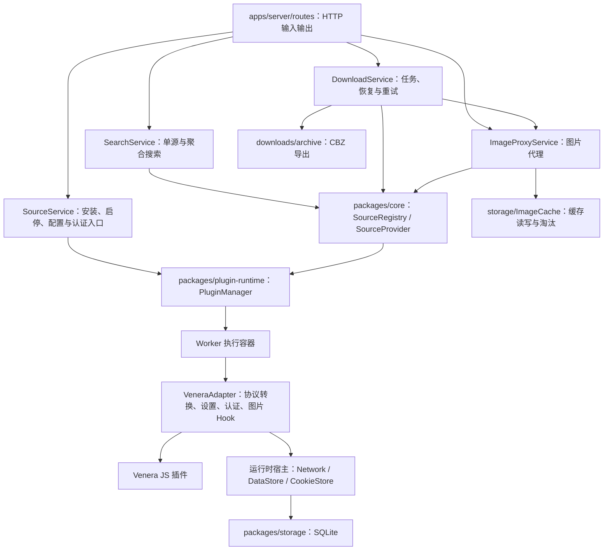

# Server 与插件运行时结构

本文描述当前实现。产品范围是源管理、搜索、聚合搜索、章节预览和下载。

## 职责与依赖



图中的模块运行于同一服务部署中；Worker 是线程，不是独立微服务。Worker 内也使用 VM。每个插件实例拥有自己的 Cookie jar、网络生命周期和 SQLite 连接，连接访问同一个数据库。

- `apps/server/src/app.ts`：HTTP 组装入口，注册鉴权、错误映射、路由及关闭钩子。
- `apps/server/src/application.ts`：创建业务服务、数据库和网络客户端，统一管理初始化与关闭。`buildApp(authConfig, config)` 接收配置快照；`readConfig()` 在入口读取并校验环境变量，`createPaths(dataDir)` 为每个应用独立生成路径。业务服务不读取全局配置。
- `routes/`：解析请求、调用服务、处理 HTTP 状态；源安装与启停流程已移入服务。
- `services/sourceService.ts`：安装、启停、重载、元数据和按源调用入口。不访问 Venera 原始实例。
- `services/searchService.ts`：单源搜索与聚合搜索；指定源不存在或某个源失败时，其他源结果仍返回。
- `services/imageProxy.ts` 与 `storage/imageCache.ts`：分别管理图片代理和文件缓存。缓存命中仍返回原有 Content-Type 探测结果。
- `services/downloads/`：`DownloadService` 管理业务命令与状态；`DownloadScheduler` 管理并发和执行句柄；`DownloadRunner` 执行章节解析、图片下载和重试；`DownloadRepository` 负责持久化访问。文件写入与 CBZ 归档保持独立。未为一行转发单独引入 ComicService。
- `repositories/sourceRepository.ts`：远程仓库索引、脚本下载与文件替换；失败安装保留既有脚本回滚行为。
- `packages/core`：与 HTTP、Venera 和 Node 执行方式无关的源接口与领域模型。
- `packages/plugin-runtime`：管理已加载实例、并发、超时和诊断。`adapters/venera` 解释旧插件协议，`executors` 负责调用与线程通信。
- `packages/contracts`：HTTP 契约；`openapi.yaml` 是唯一契约源文件，生成类型与运行时文档。

依赖方向为 `server → core/plugin-runtime/storage/contracts`；`plugin-runtime → core/storage`。运行时不读取 server 的配置模块、路径模块或服务。应用配置通过 `RuntimeOptions` 注入，Worker 和 compute 子线程接收同一配置快照。

## 应用与下载生命周期

启动流程为配置校验、资源创建、目录初始化、加载源、恢复下载、监听 HTTP。初始化失败会释放资源。收到 SIGINT/SIGTERM 后，Fastify 停止接收请求，preClose 停止下载调度并等待执行结束；HTTP 请求和 SSE 结束后，再关闭源 Worker、网络代理客户端和 SQLite。关闭可重复调用。

SQLite 是下载任务状态的唯一来源，查询返回独立快照。调度器仅持有执行句柄和每次运行独立的 AbortController，不缓存可变任务对象。状态与日志一起落库后再发布事件，订阅者收到快照，不会被后续更新修改。

纯进度变化立即落库，但通过一个服务级 100ms 定时窗口合并广播；窗口结束时才读取当前完整任务列表，不为窗口内每次变化查询、克隆及推送列表。创建、删除和任务状态切换立即广播最新快照，同时清除待发的进度通知，因此暂停、取消、失败、完成与关闭恢复状态不等待该窗口。订阅时仍立即发送当前快照；快照表达当前状态，不保证逐条交付中间进度。

无订阅者时不安排广播，最后一个订阅者离开或服务关闭时清理待发定时器。延迟读取失败交给 `onError`，后续进度仍可安排新的通知。事件仍发送完整任务列表，尚未改为增量协议，也未合并每次进度的数据库写入。

SSE 路由使用 `DownloadService.subscribeSerialized()` 订阅 JSON 字符串。同一次广播只读取一次任务列表并序列化一次，所有 SSE 连接共享该不可变字符串，不再按连接重复克隆任务对象和序列化。进程内的对象订阅 `subscribe()` 仍逐订阅者提供独立快照，两类订阅共享原有的 100ms 合并、即时状态通知与清理规则；对象订阅者修改自己的快照不影响 SSE 内容。新连接仍单独读取并立即发送当前完整列表，不跨广播持久缓存旧 JSON。某个订阅者回调失败不会阻止其他订阅者接收。

HTTP 层通过 `routes/downloadSnapshotWriter.ts` 处理各 SSE 连接的背压。`write()` 返回 false 后暂停该连接的快照写入，只保留一份最新待发快照，后续快照覆盖待发值；收到 `drain` 后重新检查鉴权再发送。未发生背压时保持正常推送，慢连接不保证收到所有中间状态。背压期间跳过心跳写入，心跳不覆盖待发快照；连接关闭时清理待发数据及 `drain` 监听器。每秒一次的鉴权检查和 `auth-expired` 关闭流程继续保留。此机制限制待发快照数量，不限制单个完整快照的大小，也不减少服务端生成快照与序列化的次数。

- `queued/running → paused`：停止当前执行，保留图片记录；`paused/failed → queued`：恢复任务，但等待旧执行释放并发槽后才启动下一次运行。
- `queued/running/paused → cancelled`：持久化取消状态。旧运行收到取消信号后不能覆盖此状态，也不会把取消记为图片下载失败。
- 删除：阻止该任务的新操作，停止并等待运行或重试结束，然后按请求清理文件，最后在事务中删除任务及图片记录。同一漫画正在删除时，不允许新建下载。
- 正常关闭：运行中的任务保存为 `queued`，显式暂停或取消状态保留。重启恢复原有 `queued/running` 任务，并跳过记录为完成且仍存在的图片文件。
- 单图重试、批量重试和 CBZ 生成也受执行句柄管理。运行或排队中的任务需先暂停才能单图重试；冲突操作返回 `DOWNLOAD_BUSY`（409）。

取消可立即中断重试退避等待；已发往插件的调用仍需等待返回或运行时超时。取消后检查执行信号，不再开始后续写入；正在进行的文件操作结束后才允许删除或关闭数据库。

下载持久化结构与 HTTP 字段保持兼容，服务统一使用 SQLite。旧 JSON 数据仍通过 `storage import-json` 显式导入，不再保留下载服务内的双存储分支。

路由仅依赖所需服务，不直接查询数据库。认证服务封装会话和 Token 操作，应用错误由独立 `AppError` 表达，HTTP 层映射状态码。存储模块显式定义源、任务及图片记录类型。

源安装、启停和全量重载按顺序执行，关闭等待这些操作完成。单源启停只加载或卸载目标实例，保留其他源的 Worker；手动全量重载仍会替换全部已加载实例。

## 下载调度、记录查询与批量重试

调度器有空闲并发槽时，通过 `DownloadRepository.queuedIds()` 调用存储层的 `listQueuedDownloadIds()`，只查询 `status = 'queued'` 的任务 ID，并按 `created_at` 升序返回；不再为调度读取和解析所有历史任务的 `task_json`。正在删除的任务仍被排除。并发槽已满时跳过队列查询，活动执行结束释放槽位后再次触发调度。该优化未新增数据库索引或改变任务列表接口，排队查询仍需按数据库中的状态筛选。

创建任务时通过 `DownloadRepository.forComic()` 一次查询相同 `source_key/comic_id` 的候选任务，按创建时间排序；不再为了去重完整读取历史任务两次。删除互斥覆盖同一漫画的所有候选任务，去重继续区分全本与单章，复用排队、运行、暂停或完成的等价任务，失败和取消的任务允许重新创建。查询返回独立快照且每次重新访问 SQLite，不维护另一个可能过期的任务索引。当前未为该查询新增复合索引；优化消除了无关任务的 JSON 传输和解析，数据库仍需筛选任务行。

`getDownloadItem(taskId, imageKey)` 使用写入时相同的 `${taskId}:${imageKey}` 主键定位，避免逐图恢复时反复筛选同一任务下的全部图片记录；查询同时校验 `task_id` 和 `image_key`，即使含冒号的输入拼成相同 ID，也不会读取其他任务或图片的记录。恢复仍核验完成记录对应的磁盘文件是否存在，文件缺失时重新下载。本次查询优化不修改现有主键编码或迁移数据。

全本下载逐章消费图片列表，不再等待整本章节解析和一次全本文件统计。首章就绪后立即开始该章图片下载，同时最多向前预取一章；章节解析最多一个请求在途，内存中最多保留当前章和下一章的图片列表。图片并发仍由 `VENERA_DOWNLOAD_CONCURRENCY` 控制，实际源调用继续受 `VENERA_PLUGIN_SOURCE_CONCURRENCY` 限制；源并发设为 1 时关闭章节预取，避免下一章请求抢占当前章的图片调用。

任务新增可选的 `totalKnown`：false 表示 `total` 仅统计已发现章节的页数，最后一章解析后设为 true；旧任务省略该字段时沿用总数已知的语义。每次运行重新从已发现章节核验和累计进度，复用已完成且文件存在的图片，文件缺失则补下。已有文件不逐张触发任务写库，在章节结束或新图片完成时发布累计进度，替代原来的全本准备统计；下载过程只保留逐图实际使用前的完成记录和文件核验。

下一章预取失败在消费该章时抛出，之前章节已完成的文件与记录保留，恢复时重新解析并复用这些文件。当前章图片失败或用户取消时不开始更后章节；所有在途图片处理和唯一的预取调用结束后，才释放执行句柄，维持删除、关闭与恢复互斥。不强制取消已进入插件的调用。元数据仍在所有章节成功后写入。

批量失败图片重试通过 `DownloadRunner.createImageRetry()` 创建本次执行专用的重试函数，惰性加载漫画详情和各章节图片列表。成功结果只在这一次批量操作内复用，章节图片键映射到原始页序号；同一图片键重复出现时保留首次出现的位置，维持文件命名语义。后续单图或批量操作会重新获取源数据，不跨操作缓存详情与章节列表。

调度器保证同一任务的批量操作独占执行，批次内逐张串行重试。解析过的章节汇入统一的图片位置索引，已知键直接定位章节和原始页序号，不再为每张图片从首章遍历已完成的章节 Promise。未知键从下一尚未解析的章节继续查找，找到后停止；章节加载失败时不推进游标，后续图片仍可重新请求该章节。索引仅存活于当前操作，内存规模仍随已解析图片数增长。

详情或章节加载失败后移除对应的失败结果，使批次中的后续图片仍可重新请求；单张图片失败不阻止其他图片继续重试。每张图片保留独立的持久化结果和进度更新。取消时仍检查执行信号，已发往插件的调用返回后不再开始后续下载或写入。

批量重试通过 `listFailedDownloadImageKeys(taskId)` 在 SQLite 中筛选 failed 状态，并按记录 ID 顺序只返回图片键；不将全部图片记录搬入 JavaScript 再筛选。仅有 error 文本但状态为 completed 的记录不进入这个命令，仍与图片明细的 failedOnly 展示筛选区分。SQL 仍可能检查该任务全部记录，本次没有为 failed 状态新增索引。

响应直接使用 `{ task, retried, results }`：最终任务快照只放外层，成功项为 `{ imageKey, ok: true, item }`，失败项为 `{ imageKey, ok: false, error }`。不再返回每项的 result/task 嵌套，也不提供旧响应模式。当前唯一客户端为同仓库网页，服务端、OpenAPI 和网页类型同步升级；网页仍在操作完成后刷新当前明细页与任务快照。单图重试继续返回该单次操作的任务和图片记录。

## 图片明细分页

新增 `GET /api/v1/downloads/{taskId}/items/page`，由存储层按记录 ID 排序并用 LIMIT/OFFSET 读取一页，默认 100 条、最多 200 条。`failedOnly` 先筛选状态为 failed 或带非空错误的记录，再计算页数和取页；`failedTotal` 始终返回该任务中状态为 failed 的总数，供当前页没有失败图片时仍展示批量重试入口。统计和页面读取在同一只读事务中完成，避免不同数据库快照导致计数不一致。

`GET /items` 返回完整数组，网页使用 `/items/page`；批量失败重试处理该任务全部失败记录，不限制为当前页。图片记录主键和分页响应格式保持不变。数据库版本 6 新增 `(task_id, id)` 复合索引 `idx_download_items_task_order`，让限定任务后的记录顺序直接用于分页及旧完整明细查询，避免额外临时排序；原有 task_id 索引保留。索引创建和版本记录在同一事务内，旧数据不重写，版本 5 的鉴权初始化仍保留。统计仍需检查该任务记录，深 OFFSET 也仍需越过前面记录，不视为常数时间查询。任务列表和 SSE 仍返回完整任务快照，任务卡片分页发生在前端。

## CBZ 归档准备与复用

已完成任务可通过 POST 准备 CBZ，也可直接 GET 下载。准备、读取及删除仍遵循下载执行器互斥与关闭规则。客户端先准备再 GET 时，同一进程内复用已成功生成且未失效的归档，避免重复打包；重启后首次请求会重新生成，不将历史磁盘文件直接视为有效缓存。

归档版本覆盖全本/单章共享或包含的输出目录，相关任务更新时间和进程内修订计数变化均使缓存失效，避免同毫秒更新漏判；相关任务在生成期间改变时不缓存该次结果。归档文件被删除时自动重新生成。手动在应用外修改图片文件不参与版本计数，需要重启服务或通过应用内任务更新使归档失效。

生成先写同目录临时归档，成功后原子替换，失败清理临时文件且不缓存失败结果；删除任务释放对应归档缓存及修订信息。归档继续按文件名排序并保留目录结构，排除 `metadata.json`、已有 `.cbz` 和本应用的临时归档，避免全本/单章并行准备时将未完成归档打入全本。JPEG、PNG、WebP、GIF、AVIF 使用 ZIP 的 STORE 方法直接存储，其他文件保留 DEFLATE 压缩。

目录遍历使用 `readdir({ withFileTypes: true })` 返回的类型信息，普通文件和目录不再额外逐项调用 `stat`；符号链接仍通过 `stat` 跟随目标。排序保持原有字符串顺序，未改为按本地语言排序。先完成遍历再打开输出流，断开的符号链接等遍历错误不会留下新输出文件。此优化仅减少遍历阶段的类型查询，归档库读取文件时仍可执行自身的元数据查询。

本地同规模样本（60 页约 13MB JPEG）打包耗时约 186ms → 40ms，CPU 消耗约 233ms → 64ms；这是临时目录下的抽样，不代表 NAS 或浏览器下载耗时。`archive.test.ts` 覆盖图片字节与 ZIP 结构、归档复用、删除/相关任务变化后的失效、同时间戳更新及失败恢复。

## 图片缓存维护

图片接口的 `thumbnail` 查询参数只接受 `true`/`false`，显式 `false` 必须传递为布尔 false，不能用 JavaScript 字符串真值转换成 true。省略参数时沿用原图加载默认值；前端原图 URL 省略该参数，同时避开旧版错误 `thumbnail=false` 响应的浏览器缓存，封面继续显式传 true。

`ImageProxyService` 对启用缓存的请求，按固定顺序构造 `sourceKey/comicId/episodeId/imageKey/thumbnail` 字段。该对象同时用于进行中请求的合并和磁盘缓存键计算，因此 HTTP 预览与下载器即使以不同字段顺序构造请求，也可复用同一图片。不同源、漫画、章节、图片键和缩略图参数保持隔离；`thumbnail` 的省略、false 和 true，以及 `episodeId` 的省略和 null 不合并。

`loadBytes(input, true)` 保持缓存读写语义，HTTP 图片预览继续使用该策略；`loadBytes(input, "read-only")` 读取已有缓存，未命中时加载图片但不新增缓存内容，命中仍沿用访问时间更新，下载和单图重试使用该策略；`loadBytes(input, false)` 保持绕过缓存与请求合并。`mock://` 图片仍直接生成，不进入此流程。

同一实例内，读写缓存与只读缓存请求按相同图片键合并一次缓存读取和上游加载。需要写缓存的预览请求共享一次写入，只读下载请求取得字节后不等待这次预览写入；预览缓存写入失败不使并发下载失败。引用计数使进行中条目保留到所有代理调用退出，覆盖上游已返回但缓存仍在写入时到达的请求；退出后释放字节和失败结果，不跨请求长期缓存内存数据。等待同一未命中请求的调用者均得到 cached=false，之后实际命中磁盘缓存才返回 cached=true。

下载图片未命中缓存时，图片内容只写入下载目录，不再额外写入临时图片缓存。输出写入临时失败时，在该单图执行期间复用已取得的字节进行重试；若上游加载本身失败，则后续尝试重新请求。结束或取消后释放该局部字节引用。纯下载不再预热预览缓存，之后首次预览可能再次请求源图片；已有预览缓存仍可用于下载，不直接将下载目录当作图片代理的缓存。

缓存键仍使用 JSON 字符串的 SHA-256 文件名，但代理输入现已固定字段顺序。升级前按其他字段顺序生成的旧缓存不迁移，首次访问可能重新下载；旧文件仍参与容量统计与淘汰，不影响下载输出文件。

`ImageCache` 首次写入前扫描已有文件，按访问时间建立内存索引；后续写入按键增量更新文件大小和淘汰顺序，不再每张图片扫描整个目录。读取命中更新访问时间与索引顺序，超过容量时淘汰最久未使用的条目；上限为 0 保持不限容量的既有语义。

写入、清空、统计和裁剪在单实例内按序执行。图片读请求仍可并行，写入使用同目录临时文件与原子替换，避免读到半张图片；维护时清理匹配缓存写入格式的残留临时文件。I/O 失败后使索引失效，下次操作重新核对磁盘，不让一次失败永久阻断后续操作。

显式 `cacheStats` 和 `enforceCacheLimit` 重新扫描磁盘，兼容外部文件清理和手动裁剪。扫描用最多 8 个工作循环并发查询文件元数据，仍须核对全部文件；不改为返回旧统计或启动后台扫描。所有工作循环结束后才替换索引，任一查询失败也先等其他在途查询结束，再由原有队列失效索引并允许后续维护。增量索引按应用内一个缓存实例管理同一目录设计，不提供多个应用进程同时写同一缓存目录的协调；请求合并也不跨实例或跨进程。统计响应格式未变。

本地临时目录基准（每个文件 1KiB、5000 个已有文件）：后续写入中位数约 56ms → 0.3ms；新实现首次建立索引仍约 62ms。该结果反映消除重复扫描的收益，不代表 NAS 磁盘、冷启动或上游图片下载的耗时。`imageCache.test.ts` 覆盖 LRU、覆盖写入、并发清空、重启及外部清理后的核对、容量边界和 I/O 失败恢复。

## 统一源接口

`SourceProvider` 是单个源的异步接口，`SourceRegistry` 按 key 查找源并枚举元数据。接口包括：

- `metadata`：真实能力与搜索选项；不能因存在 Worker 就推断支持搜索或详情。
- `search`：命名参数 `keyword/page/cursor/options`，统一漫画结果。
- `comicDetails/comicPages/loadImageBytes`：详情、章节、图片字节。
- `settings/updateSettings/resetSettings/invokeSetting`：设置定义、持久化值、恢复默认、回调按钮。
- `auth/login/logout`：源账号能力、状态、登录与退出。
- `cookies/importCookies/clearCookies`：当前实例的 Cookie 管理。

不支持的能力返回 `SOURCE_CAPABILITY_UNSUPPORTED`。设置无效返回 `SOURCE_SETTINGS_INVALID`，登录失败返回 `SOURCE_LOGIN_FAILED`。已识别的拷贝漫画客户端访问限制返回 `SOURCE_ACCESS_RESTRICTED`，业务 HTTP 映射为 403 和固定安全文案；识别条件与复测限制见 [真实源兼容记录](source_compatibility.md#2026-10-29-拷贝漫画访问限制排查)。Worker 传递统一错误码，不把错误全部退化为字符串。

Venera 的 `load/loadNext`、`subTitle`、章节 Map、图片 Hook 别名由适配器转换。图片回调与闭包始终在原执行环境中处理，线程之间只传递最终字节。VeneraAdapter 在 Worker 内通过 VM 加载插件。

`baozi/comick` 专用补丁保留在 `adapters/venera/sourcePatches.ts`，不进入业务服务。原来的缩略图转原图规则仅用于 `nhentai`，不再把任意源的章节失败转换成缩略图列表。真实源可用性依然受远端变更影响，本次离线回归不能代替真实站点验证。

## 设置与源账号

普通设置支持输入、选择、开关、默认值和回调操作。保存会先验证整批参数，通过后才写入；拒绝未定义字段及把 callback 当作普通值保存。输入设置兼容旧源的数字默认值。初始化前保存定义与 callback，避免插件 init 修改设置对象导致定义丢失。

账号密码通过 `account.login` 执行，成功后遵循 Venera 的 `account` 数组语义持久化。Cookie 登录调用插件提供的字段与 `validate`；插件同时提供密码登录时沿用 Venera 的密码优先规则。登录与退出串行执行。失败登录恢复之前的 account 与 Cookie 状态；插件对其他私有数据的任意修改不具备通用事务回滚保证。

密码不会通过设置、账号状态或登录响应返回，登录异常文本也不进入客户端与运行时诊断，避免插件回显凭据。为兼容插件读取原始账号数据，凭据目前保存在本地 SQLite 插件数据中，尚未实现静态加密。数据库备份应按凭据文件管理。通用 Cookie 导出仍属于受本站鉴权保护的管理接口。

退出执行插件 logout，清除 account 和 Cookie。导入与清空 Cookie 直接作用于运行中的插件，不需要重新执行 init。网页/WebView 登录能力返回 `webview: unsupported`；尚无浏览器验证会话或验证码交互实现。

本站管理员认证仍在 `apps/server/src/auth`，与源账号完全独立。

## 执行边界与验证

Worker 是唯一执行方式，内部 VM 提供 Venera 脚本上下文。调用超时会终止该实例，后续需要重载；插件同步死循环也不会阻塞服务主线程。Worker 与 VM 均不提供操作系统级安全隔离。已移除 `VENERA_PLUGIN_ISOLATION` 配置和兼容检查 CLI 的 `--isolation` 参数，统一使用 `compat` 命令。

新增方法时必须同时更新 core 接口和执行器的完整操作清单；不要添加任意字符串方法调用或把原始插件对象返回给 server。

常规验证：

```sh
pnpm --filter @venera/contracts generate:check
pnpm build
pnpm typecheck
pnpm lint
pnpm test
```

`apps/server/test/sourceProvider.test.ts` 在 Worker 模式下覆盖能力、搜索选项、设置校验、callback、密码与 Cookie 登录、重载持久化和 Cookie 同步。原有图片回调、下载、鉴权与异步错误隔离测试继续保留。前端 `sourceControls.test.tsx` 覆盖设置控件、登录提交及切换源后凭据清理。

`downloadLifecycle.test.ts` 覆盖暂停、快速恢复、取消后的并发槽释放、运行中删除、重跑、关闭等待、重启恢复和事件快照；`applicationLifecycle.test.ts` 覆盖多实例隔离、初始化失败清理、单源启停和配置校验。

性能优化相关回归入口：

- `imageProxy.test.ts`：同图并发合并、不同字段顺序与代理重建后的磁盘缓存复用、缓存清理、上游及写缓存失败后恢复、缓存绕过和图片上下文隔离；只读缓存命中/未命中、混合请求合并、写入期间晚到请求和缓存写入错误隔离。
- `downloadImageWrites.test.ts`：真实代理与下载写入链路不重复写缓存，复用预览缓存，输出写入重试复用字节，上游失败后重新获取。
- `downloadScheduler.test.ts`：满载时不查询队列，释放槽位后继续按顺序调度；`packages/storage/src/index.test.ts` 覆盖排队筛选、顺序、状态变化和图片记录的精确匹配。
- `downloadCreation.test.ts`：按源和漫画限定候选任务，各状态的去重/重建、全本与单章隔离、创建顺序与快照独立性；`downloadLifecycle.test.ts` 另覆盖删除期间阻止同漫画新建任务。
- `downloadEvents.test.ts`：100 次进度即时持久化但合并为一次列表查询与通知，暂停/取消/完成立即推送最新进度，退订与关闭清理定时器，以及延迟读取失败后的恢复；多个 SSE 订阅者每次广播只序列化一次、不克隆对象，混合订阅隔离，初始订阅和广播回调失败后的清理与错误隔离。
- `downloadSnapshotWriter.test.ts`：低写缓冲阈值下只保留首个与最新快照，心跳不覆盖待发数据，恢复可写后重新检查鉴权，关闭后清理监听器，正常可写连接保留各次通知。
- `downloadRetry.test.ts`：批次内复用、原始页位置与文件内容、跨批次重新获取、详情/章节临时失败后恢复、章节加载期间取消；乱序重试与按需解析、章节内及跨章节重复键保留首次位置、后续章节失败后恢复、未知键不影响已解析位置；批量只读取失败键、成功/失败的精简响应、空批次不访问源，以及关闭时等待在途图片且不派发后续键。
- `downloadRepository.test.ts`：仅复用完成且磁盘文件存在的记录，文件缺失补下，其他文件系统错误不吞掉。
- `downloadPipeline.test.ts`：首章先下载、仅预取下一章、动态总数、预取失败后的文件复用、取消和图片失败等待在途预取、关闭预取后的逐章下载。
- `imageCacheScan.test.ts`：元数据查询并发上限、清空等待在途扫描、扫描失败后重建索引。
- `downloadItemsPage.test.ts`：明细顺序、分页边界、筛选先于分页、完整失败数、任务隔离、参数校验及旧完整接口兼容。`packages/storage/src/index.test.ts` 另覆盖旧版本升级、图片记录不变和排序索引查询计划。
- `archive.test.ts`：除归档复用等已有覆盖外，校验文件名排序、文件与目录符号链接，以及断开链接时不创建输出文件。

## 2026-10-30 性能抽样

以下数据来自开发机的临时 SQLite 内存数据库、临时文件目录或测试替身，不是 NAS/VPS 实测，也不代表完整下载、打包或浏览器交互耗时。抽样脚本为当次临时验证脚本，未作为持续基准纳入仓库；请求次数与行为边界由上述回归测试约束。

| 路径         | 样本与测量范围                                                         | 优化前 → 优化后     |
| ------------ | ---------------------------------------------------------------------- | ------------------- |
| 图片请求合并 | 同图 20 个并发请求，上游加载次数                                       | 20 → 1              |
| 图片记录查询 | 同一任务 1 万条记录，2000 次预编译 SQL 查询总耗时                      | 约 224.4ms → 1.7ms  |
| 调度队列查询 | 2000 条完成任务、20 条排队任务，每条含 30 条日志；10 次查询中位数      | 约 8.51ms → 0.17ms  |
| 归档目录遍历 | 同目录 2000 个普通文件，仅遍历与识别类型；5 次中位数                   | 约 28.34ms → 0.79ms |
| 批量失败重试 | 两章共四张失败图片；详情请求 / 章节请求次数                            | 4 / 6 → 1 / 2       |
| 进度广播     | 同一 100ms 窗口内连续 100 次纯进度变化；列表读取及通知次数             | 100 → 1             |
| 恢复准备统计 | 1000 张完成图片，一次记录读取与并发数 4 的文件核验；5 次中位数         | 约 15.52ms → 5.24ms |
| 创建任务去重 | 2000 条历史任务、同一漫画 20 条候选任务，每条含 30 条日志；10 次中位数 | 约 13.44ms → 0.20ms |

图片记录查询样本只比较查询路径，不包含应用中每次准备 SQL、磁盘文件存在性核验或图片下载的耗时；归档遍历样本不包含 ZIP 生成和图片读取。真实部署的后续重点仍包括大缓存冷启动、完整任务列表的 SSE 推送，以及不同外部漫画源的网络耗时。

共享 SSE 序列化另以真实 `DownloadService` 和临时目录中的 SQLite 测量：1000 个任务、每任务 10 条日志、消息长度 80 个 ASCII 字符，4 个订阅回调，每次样本触发 20 次即时广播，前后各三次。优化前回调分别序列化对象快照，优化后直接消费共享字符串；没有计入实际 HTTP 网络写入。广播总耗时中位数约 338.36ms → 57.79ms，进程 CPU 时间中位数约 342.43ms → 58.99ms；每组前后对应样本的累计 JSON 字节数一致，证明该优化减少服务器计算，未减少客户端所需接收的内容或带宽。单个连接的提升与多连接样本不同，真实部署仍需验证。

## 2026-10-30 章节流水线与大数据量抽样

章节样本为 20 章、每章 4 张图片，模拟章节请求 15ms、图片请求 10ms，图片并发 4；使用真实 DownloadRunner、SQLite 与临时目录落盘，前后各三次。首张图片请求启动时间中位数约 314.57ms → 16.91ms，总执行时间约 556.33ms → 325.69ms；两版都发现 80 页并完成 80 页，观测到章节请求最多 1 个、图片请求最多 4 个。这里测量的是图片请求开始时间，不是浏览器图片显示时间，也不代表真实源延迟。

缓存统计样本为临时目录 20000 个普通文件、每文件 1KiB，前后各三次，完整扫描中位数约 218.36ms → 80.15ms，文件数和字节数一致。结果仅来自开发机文件系统；NAS 的元数据 I/O 并发收益仍需实测，当前未引入后台统计或修改外部清理核对语义。

此前表格中的“恢复准备统计”记录的是早期全本准备算法对比；当前流水线已移除这个整本统计步骤，在逐章图片消费时累计完成数。任务卡片与明细分页的浏览器抽样见 [前端大任务记录](web_architecture.md#2026-10-30-大任务与服务端明细分页抽样)。

## 2026-10-30 明细分页排序索引抽样

通过真实 StorageDatabase 的 listDownloadItemsPage 方法测量临时 SQLite 数据库：同一任务 100000 条记录，offset=99000、limit=100，每 100 条一条失败记录，前后各 9 次。包含完整计数与实际取页的中位数约 24.00ms → 7.30ms；迁移后查询计划使用 idx_download_items_task_order，不再出现 USE TEMP B-TREE FOR ORDER BY。结果顺序、total 和 failedTotal 均校验一致。

索引未消除计数扫描或深 OFFSET 遍历。此结果来自本地临时数据库，不代表 NAS；首次升级需创建索引，并增加索引磁盘占用与后续写入维护成本。

## 2026-10-30 下载图片写入抽样

使用真实 ImageProxyService、ImageCache、DownloadRunner、SQLite 与临时文件目录，源边界返回同一份有效 JPEG 字节，图片键为 HTTPS URL，未使用绕过缓存逻辑的 mock:// 路径。样本为 60 页，每页 774864 字节，缓存容量不限，每次使用新目录，前后各三次；在同一份存储版本 6 与代理实现上，分别使用原有读写缓存策略和新的只读缓存策略，以隔离索引迁移对比较的影响。所有输出文件均校验 SHA-256 与输入图片一致，最终完成数和总数均为 60。

只读缓存策略后，下载引发的缓存写入由 60 次、46491840 字节降为 0；下载图片内容仍写入 46491840 字节。因此这条链路的应用层图片内容写入由 92983680 字节降为 46491840 字节，减少一半。执行时间中位数约 33.09ms → 9.94ms，进程 CPU 时间中位数约 44.86ms → 25.13ms。

此样本隔离了真实外部网络延迟，未包含文件校验阶段的时间，也不将 SQLite 和 metadata.json 写入计入图片内容字节；没有强制刷盘，结果包含操作系统页缓存的影响，不是物理磁盘写放大或 NAS 吞吐测量。并发预览仍会按需写缓存，不承诺所有运行场景都减少一半写入。

## 2026-10-30 批量失败重试抽样

使用真实 DownloadService 和临时 SQLite 数据库：同一任务 100000 条图片记录、100 条 failed，任务保留 100 条日志，每条消息 80 个 ASCII 字符。图片执行边界模拟重试成功，前后各三次，每次恢复相同的失败记录和任务状态；测量选择记录、业务命令与 JSON 序列化，不包含真实图片网络和落盘。

选取阶段传给 JavaScript 的图片数据由 100000 条完整记录降为 100 个图片键；响应正文由 1604062 字节降为 39661 字节。整体命令与序列化耗时中位数约 69.41ms → 12.53ms，进程 CPU 时间约 91.59ms → 13.12ms；前后均按同一键顺序重试 100 项，最终完成数均为 100000。这里同时包含 SQL 筛选、减少任务重复读取和精简响应的收益，不将耗时变化全部归因于单一改动，不代表真实源重试耗时或 NAS 性能。

同日进一步隔离重试定位：真实 DownloadRunner，1000 章、每章 10 张图片，按章节逆序、章内原始页序重试 10000 张图片。模拟图片下载与存储边界，保留实际目录检查，逐项校验目标章节、页序号和输出目录；前后各三次。耗时中位数约 470.96ms → 175.91ms，进程 CPU 时间约 490.28ms → 190.30ms；两版均只请求一次详情、1000 次章节并执行 10000 次图片下载边界。这是减少已解析章节重复遍历的受控样本，不包含图片网络、图片落盘或 SQLite，也不是端到端下载速度测量。
