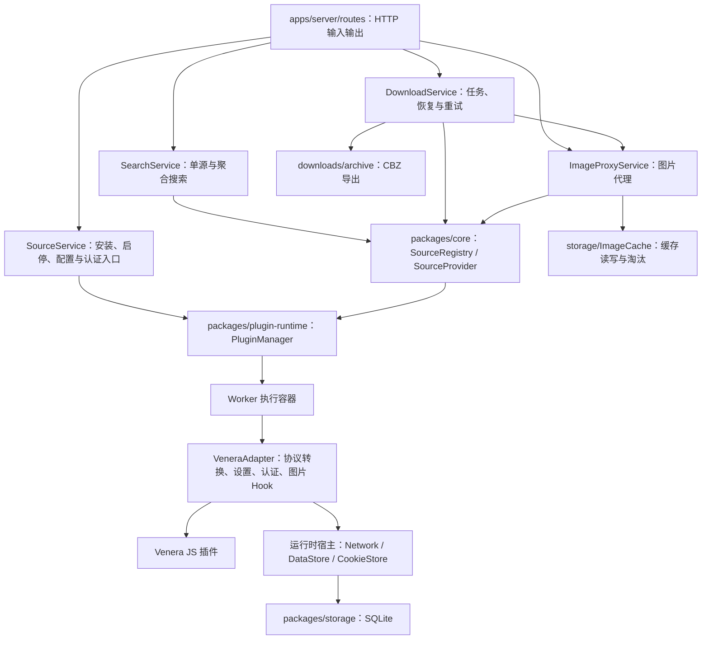

# Server 与插件运行时结构

本文描述当前实现。产品范围是源管理、搜索、聚合搜索、章节预览和下载。

## 职责与依赖



图中的模块运行于同一服务部署中；Worker 是线程，不是独立微服务。Worker 内也使用 VM。每个插件实例拥有自己的 Cookie jar、网络生命周期和 SQLite 连接，连接访问同一个数据库。

- `apps/server/src/app.ts`：HTTP 组装入口，注册鉴权、错误映射、路由及关闭钩子。
- `apps/server/src/application.ts`：创建业务服务、数据库和网络客户端，统一管理初始化与关闭。`buildApp(authConfig, config)` 接收配置快照；`readConfig()` 在入口读取并校验环境变量，`createPaths(dataDir)` 为每个应用独立生成路径。业务服务不读取全局配置。
- `routes/`：解析请求、调用服务、处理 HTTP 状态；源安装与启停流程已移入服务。
- `services/sourceService.ts`：安装、启停、重载、元数据和按源调用入口。不访问 Venera 原始实例。
- `services/searchService.ts`：单源搜索与聚合搜索；指定源不存在或某个源失败时，其他源结果仍返回。
- `services/imageProxy.ts` 与 `storage/imageCache.ts`：分别管理图片代理和文件缓存。缓存命中仍返回原有 Content-Type 探测结果。
- `services/downloads/`：`DownloadService` 管理业务命令与状态；`DownloadScheduler` 管理并发和执行句柄；`DownloadRunner` 执行章节解析、图片下载和重试；`DownloadRepository` 负责持久化访问。文件写入与 CBZ 归档保持独立。未为一行转发单独引入 ComicService。
- `repositories/sourceRepository.ts`：远程仓库索引、脚本下载与文件替换；失败安装保留既有脚本回滚行为。
- `packages/core`：与 HTTP、Venera 和 Node 执行方式无关的源接口与领域模型。
- `packages/plugin-runtime`：管理已加载实例、并发、超时和诊断。`adapters/venera` 解释旧插件协议，`executors` 负责调用与线程通信。
- `packages/contracts`：HTTP 契约；`openapi.yaml` 是唯一契约源文件，生成类型与运行时文档。

依赖方向为 `server → core/plugin-runtime/storage/contracts`；`plugin-runtime → core/storage`。运行时不读取 server 的配置模块、路径模块或服务。应用配置通过 `RuntimeOptions` 注入，Worker 和 compute 子线程接收同一配置快照。

## 应用与下载生命周期

启动流程为配置校验、资源创建、目录初始化、加载源、恢复下载、监听 HTTP。初始化失败会释放资源。收到 SIGINT/SIGTERM 后，Fastify 停止接收请求，preClose 停止下载调度并等待执行结束；HTTP 请求和 SSE 结束后，再关闭源 Worker、网络代理客户端和 SQLite。关闭可重复调用。

SQLite 是下载任务状态的唯一来源，查询返回独立快照。调度器仅持有执行句柄和每次运行独立的 AbortController，不缓存可变任务对象。状态与日志一起落库后再发布事件，订阅者收到快照，不会被后续更新修改。

- `queued/running → paused`：停止当前执行，保留图片记录；`paused/failed → queued`：恢复任务，但等待旧执行释放并发槽后才启动下一次运行。
- `queued/running/paused → cancelled`：持久化取消状态。旧运行收到取消信号后不能覆盖此状态，也不会把取消记为图片下载失败。
- 删除：阻止该任务的新操作，停止并等待运行或重试结束，然后按请求清理文件，最后在事务中删除任务及图片记录。同一漫画正在删除时，不允许新建下载。
- 正常关闭：运行中的任务保存为 `queued`，显式暂停或取消状态保留。重启恢复原有 `queued/running` 任务，并跳过记录为完成且仍存在的图片文件。
- 单图重试、批量重试和 CBZ 生成也受执行句柄管理。运行或排队中的任务需先暂停才能单图重试；冲突操作返回 `DOWNLOAD_BUSY`（409）。

取消可立即中断重试退避等待；已发往插件的调用仍需等待返回或运行时超时。取消后检查执行信号，不再开始后续写入；正在进行的文件操作结束后才允许删除或关闭数据库。

下载持久化结构与 HTTP 字段保持兼容，服务统一使用 SQLite。旧 JSON 数据仍通过 `storage import-json` 显式导入，不再保留下载服务内的双存储分支。

路由仅依赖所需服务，不直接查询数据库。认证服务封装会话和 Token 操作，应用错误由独立 `AppError` 表达，HTTP 层映射状态码。存储模块显式定义源、任务及图片记录类型。

源安装、启停和全量重载按顺序执行，关闭等待这些操作完成。单源启停只加载或卸载目标实例，保留其他源的 Worker；手动全量重载仍会替换全部已加载实例。

## 图片缓存维护

`ImageCache` 首次写入前扫描已有文件，按访问时间建立内存索引；后续写入按键增量更新文件大小和淘汰顺序，不再每张图片扫描整个目录。读取命中更新访问时间与索引顺序，超过容量时淘汰最久未使用的条目；上限为 0 保持不限容量的既有语义。

写入、清空、统计和裁剪在单实例内按序执行。图片读请求仍可并行，写入使用同目录临时文件与原子替换，避免读到半张图片；维护时清理匹配缓存写入格式的残留临时文件。I/O 失败后使索引失效，下次操作重新核对磁盘，不让一次失败永久阻断后续操作。

显式 `cacheStats` 和 `enforceCacheLimit` 重新扫描磁盘，兼容外部文件清理和手动裁剪。增量索引按应用内一个缓存实例管理同一目录设计，不提供多个应用进程同时写同一缓存目录的协调。缓存键及统计响应格式未变。

本地临时目录基准（每个文件 1KiB、5000 个已有文件）：后续写入中位数约 56ms → 0.3ms；新实现首次建立索引仍约 62ms。该结果反映消除重复扫描的收益，不代表 NAS 磁盘、冷启动或上游图片下载的耗时。`imageCache.test.ts` 覆盖 LRU、覆盖写入、并发清空、重启及外部清理后的核对、容量边界和 I/O 失败恢复。

## 统一源接口

`SourceProvider` 是单个源的异步接口，`SourceRegistry` 按 key 查找源并枚举元数据。接口包括：

- `metadata`：真实能力与搜索选项；不能因存在 Worker 就推断支持搜索或详情。
- `search`：命名参数 `keyword/page/cursor/options`，统一漫画结果。
- `comicDetails/comicPages/loadImageBytes`：详情、章节、图片字节。
- `settings/updateSettings/resetSettings/invokeSetting`：设置定义、持久化值、恢复默认、回调按钮。
- `auth/login/logout`：源账号能力、状态、登录与退出。
- `cookies/importCookies/clearCookies`：当前实例的 Cookie 管理。

不支持的能力返回 `SOURCE_CAPABILITY_UNSUPPORTED`。设置无效返回 `SOURCE_SETTINGS_INVALID`，登录失败返回 `SOURCE_LOGIN_FAILED`。已识别的拷贝漫画客户端访问限制返回 `SOURCE_ACCESS_RESTRICTED`，业务 HTTP 映射为 403 和固定安全文案；识别条件与复测限制见 [真实源兼容记录](source_compatibility.md#2026-10-29-拷贝漫画访问限制排查)。Worker 传递统一错误码，不把错误全部退化为字符串。

Venera 的 `load/loadNext`、`subTitle`、章节 Map、图片 Hook 别名由适配器转换。图片回调与闭包始终在原执行环境中处理，线程之间只传递最终字节。VeneraAdapter 在 Worker 内通过 VM 加载插件。

`baozi/comick` 专用补丁保留在 `adapters/venera/sourcePatches.ts`，不进入业务服务。原来的缩略图转原图规则仅用于 `nhentai`，不再把任意源的章节失败转换成缩略图列表。真实源可用性依然受远端变更影响，本次离线回归不能代替真实站点验证。

## 设置与源账号

普通设置支持输入、选择、开关、默认值和回调操作。保存会先验证整批参数，通过后才写入；拒绝未定义字段及把 callback 当作普通值保存。输入设置兼容旧源的数字默认值。初始化前保存定义与 callback，避免插件 init 修改设置对象导致定义丢失。

账号密码通过 `account.login` 执行，成功后遵循 Venera 的 `account` 数组语义持久化。Cookie 登录调用插件提供的字段与 `validate`；插件同时提供密码登录时沿用 Venera 的密码优先规则。登录与退出串行执行。失败登录恢复之前的 account 与 Cookie 状态；插件对其他私有数据的任意修改不具备通用事务回滚保证。

密码不会通过设置、账号状态或登录响应返回，登录异常文本也不进入客户端与运行时诊断，避免插件回显凭据。为兼容插件读取原始账号数据，凭据目前保存在本地 SQLite 插件数据中，尚未实现静态加密。数据库备份应按凭据文件管理。通用 Cookie 导出仍属于受本站鉴权保护的管理接口。

退出执行插件 logout，清除 account 和 Cookie。导入与清空 Cookie 直接作用于运行中的插件，不需要重新执行 init。网页/WebView 登录能力返回 `webview: unsupported`；尚无浏览器验证会话或验证码交互实现。

本站管理员认证仍在 `apps/server/src/auth`，与源账号完全独立。

## 执行边界与验证

Worker 是唯一执行方式，内部 VM 提供 Venera 脚本上下文。调用超时会终止该实例，后续需要重载；插件同步死循环也不会阻塞服务主线程。Worker 与 VM 均不提供操作系统级安全隔离。已移除 `VENERA_PLUGIN_ISOLATION` 配置和兼容检查 CLI 的 `--isolation` 参数，统一使用 `compat` 命令。

新增方法时必须同时更新 core 接口和执行器的完整操作清单；不要添加任意字符串方法调用或把原始插件对象返回给 server。

常规验证：

```sh
pnpm --filter @venera/contracts generate:check
pnpm build
pnpm typecheck
pnpm lint
pnpm test
```

`apps/server/test/sourceProvider.test.ts` 在 Worker 模式下覆盖能力、搜索选项、设置校验、callback、密码与 Cookie 登录、重载持久化和 Cookie 同步。原有图片回调、下载、鉴权与异步错误隔离测试继续保留。前端 `sourceControls.test.tsx` 覆盖设置控件、登录提交及切换源后凭据清理。

`downloadLifecycle.test.ts` 覆盖暂停、快速恢复、取消后的并发槽释放、运行中删除、重跑、关闭等待、重启恢复和事件快照；`applicationLifecycle.test.ts` 覆盖多实例隔离、初始化失败清理、单源启停和配置校验。
